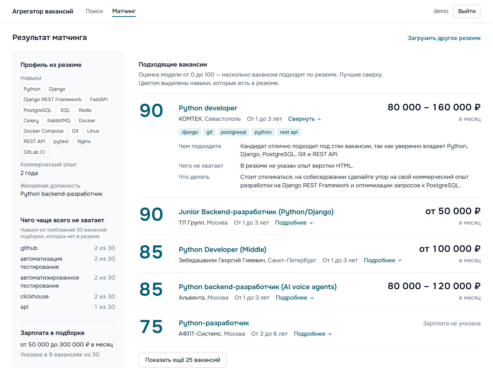
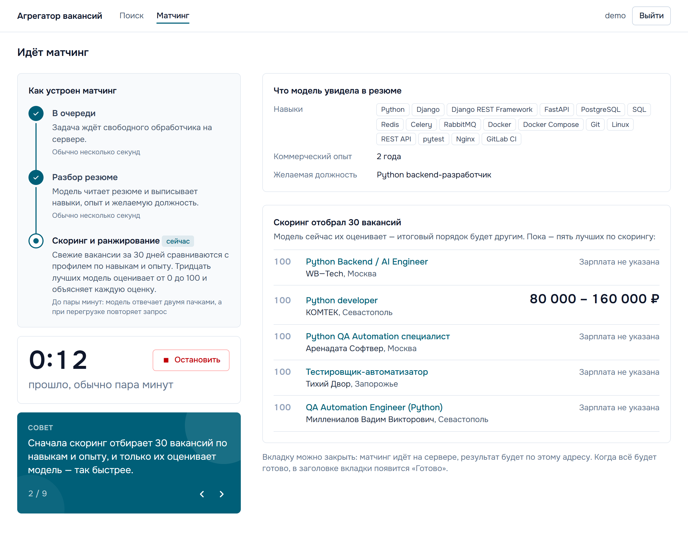
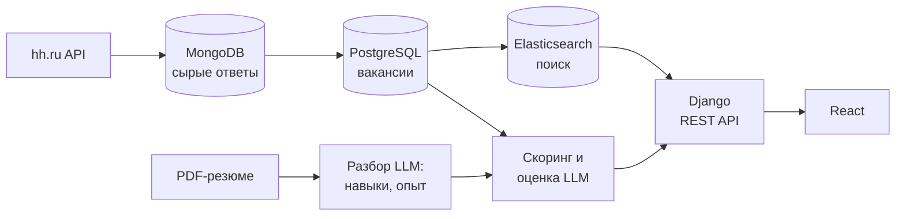
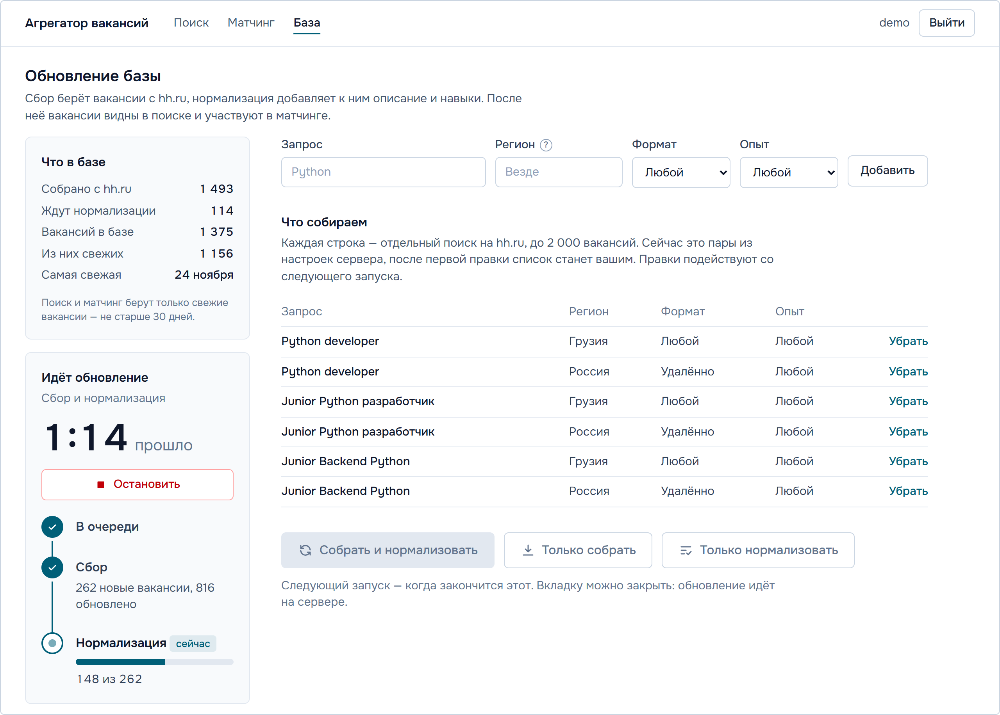
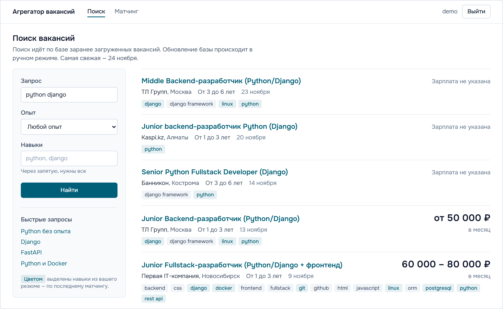

<h1 align="center">Job Aggregator</h1>

  
  
  
  
  
  
  

<h3 align="center">Подбор релевантных вакансий с hh.ru под резюме</h3>

<h3 align="center">
Сервис собирает вакансии через официальный API, а на загруженное резюме отдаёт топ-30 наиболее подходящих вакансий: по каждой видно, чем кандидат подходит, чего не хватает и стоит ли откликаться.
</h3>

 

## Как работает матчинг

1. **Разбор резюме (LLM).** Текст из PDF — сам файл не сохраняется — модель превращает в профиль: навыки, годы коммерческого опыта, желаемая должность. Ответ — по JSON-схеме.
2. **Скоринг (без LLM).** Каждая свежая вакансия получает балл: 60 % — доля её навыков, которые есть у кандидата, 40 % — соответствие опыта.
3. **Ранжирование (LLM).** Тридцать лучших уходят в модель двумя пачками по 15, набранными через одну: пачки равны по силе, и баллы из разных запросов сравнимы. По каждой вакансии — оценка, сильные стороны, пробелы и совет.

Ответ модели проверяется, негодный запрашивается заново; если ранжирование не удалось, остаётся топ по скорингу. Подойдёт любая модель с OpenAI-совместимым API, по умолчанию — Gemini.

 

## Как устроено

**Путь вакансии.** Сбор складывает ответы hh.ru в MongoDB как есть. Нормализация берёт их оттуда, запрашивает для каждой вакансии полную карточку с описанием и навыками, приводит зарплату и пишет в PostgreSQL, а в конце пачки — в индекс Elasticsearch. Сбор приносит сотню вакансий за один запрос, а нормализация тратит запрос на каждую, поэтому MongoDB служит очередью между ними: если нормализация прервётся, собранное не потеряется и разберётся при следующем запуске. Через 30 дней вакансия становится архивной

 

## Что умеет

- **Собирает вакансии** по парам «запрос, регион, формат работы, опыт». Пары задаются в интерфейсе, ход виден по стадиям, запуск можно остановить без потери сделанного.
- **Поиск по собранной базе** с учётом русской морфологии, с фильтрами по опыту и навыкам, в порядке релевантности.
- **Подбирает вакансии под резюме:** разбор PDF, скоринг всех свежих вакансий, оценка тридцати лучших моделью.
- **Убирает дубли:** дедупликация по hh id - вакансии не дублируются при сборе. В матчинге отсеиваются копии: тот же работодатель, то же название и не меньше 80 % общих слов в описании
- **Выносит долгие операции в фон:** сбор, нормализацию и матчинг выполняет воркер Celery. API ставит задачу в очередь RabbitMQ, интерфейс опрашивает статус, а в Redis хранятся замок и статус обновления базы, токен hh.ru и курсы валют.
- **Сравнивает зарплаты:** любая валюта приводится к месячной сумме в рублях.
- **Переживает сбои:** отказ модели, капчу и лимиты hh.ru, обрыв связи, остановку на полпути. Если недоступен Elasticsearch, поиск переходит на PostgreSQL.

 

## Стек

- **Бэкенд:** Python 3.12, Django 6, Django REST Framework, JWT, drf-spectacular, pypdf
- **Данные:** PostgreSQL 17, MongoDB 7, Elasticsearch 8, Redis 7
- **Фоновые задачи:** Celery, RabbitMQ
- **Модель:** любой OpenAI-совместимый API, по умолчанию Gemini Flash Lite
- **Инструменты:** Docker Compose, uv, ruff, mypy, pre-commit, ESLint, Prettier
- **Интерфейс:** React 19, TypeScript, Vite, Tailwind CSS
- **Типы API:** генерируются из OpenAPI-схемы бэкенда (drf-spectacular → openapi-typescript), так что расхождение фронта с API ловит компилятор TypeScript

## Исходный код

Код закрыт: проект живёт в приватном репозитории. Здесь — описание, схема и [скриншоты всех экранов](docs/images).

Код покажу по согласованию: main000rd@gmail.com
