# Скриншоты

Экраны агрегатора по сценариям. Описание проекта — в [README](../../README.md).

## Поиск

**Поиск по базе.** Запрос, фильтры и быстрые запросы; навыки из последнего резюме подсвечены цветом.

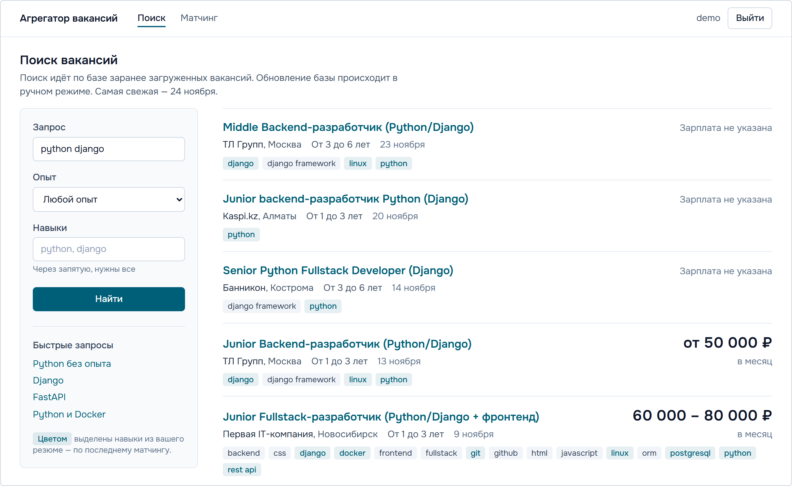

**Фильтры.** Опыт и навыки: вакансия должна содержать все перечисленные.

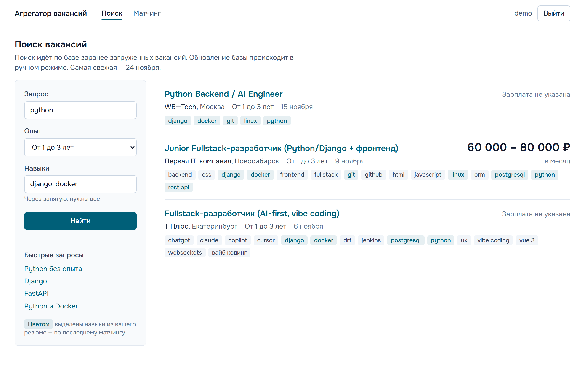

**Зарплата в другой валюте.** Пересчитана в рубли за месяц по курсу hh.ru, исходная сумма — рядом.

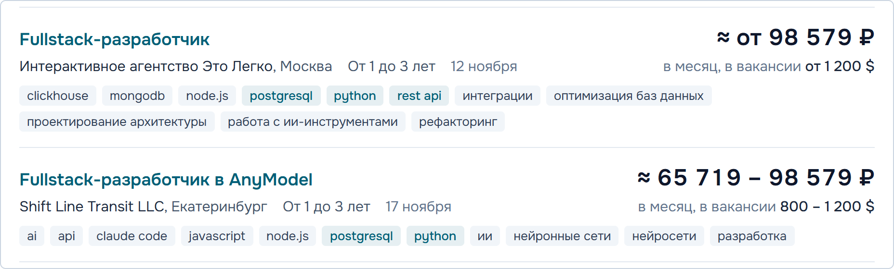

## Вход

**Вход.** Матчинг открывается после входа, поиск работает и без него.

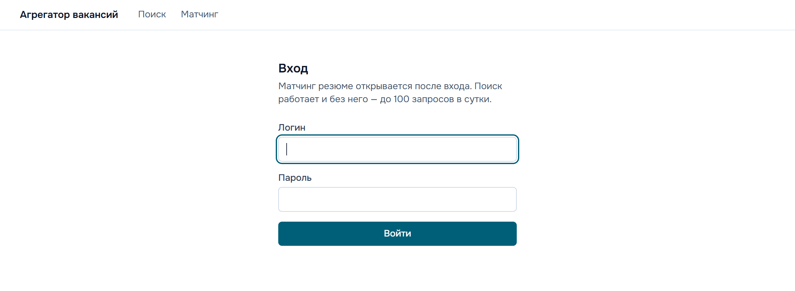

## Матчинг резюме

**Загрузка.** Резюме в PDF до 5 МБ; слева — прошлые матчинги, которые запомнил браузер.

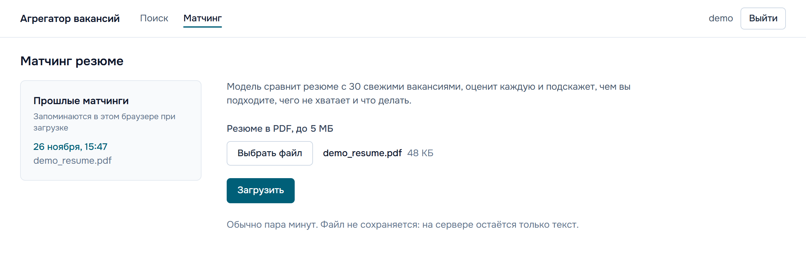

**Ожидание.** Стадии, профиль из резюме и пять лучших по скорингу, пока модель оценивает тридцать отобранных. Матчинг можно остановить.

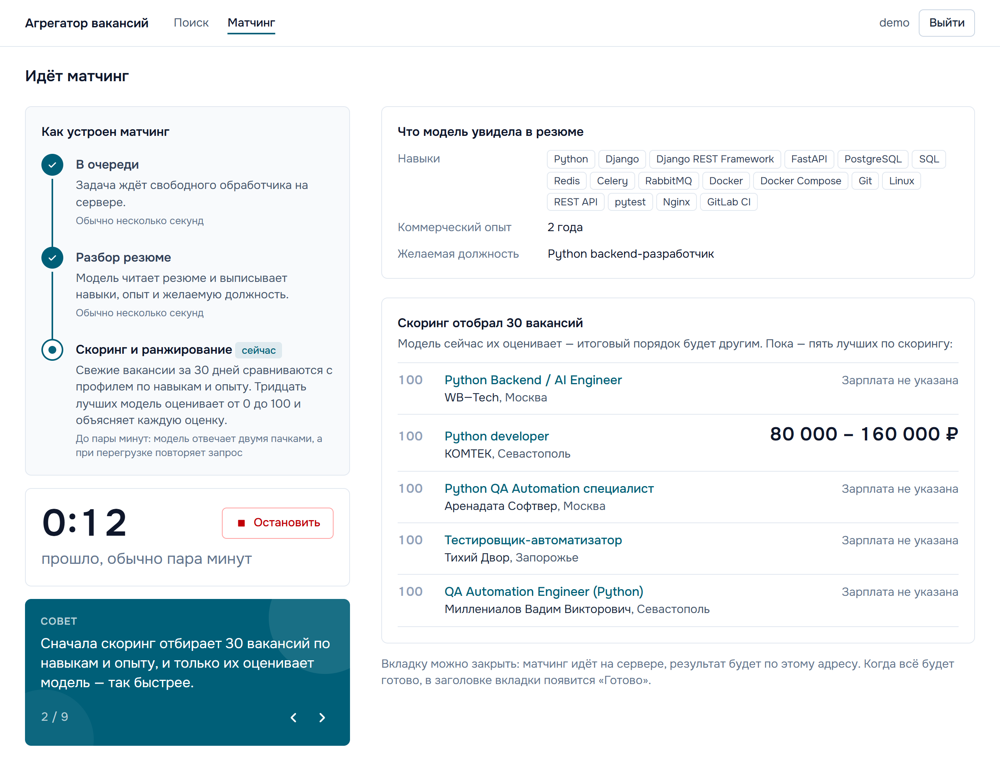

**Результат.** Оценка модели от 0 до 100, у первой вакансии раскрыто объяснение. Слева — профиль, чего чаще всего не хватает и зарплаты в подборке.

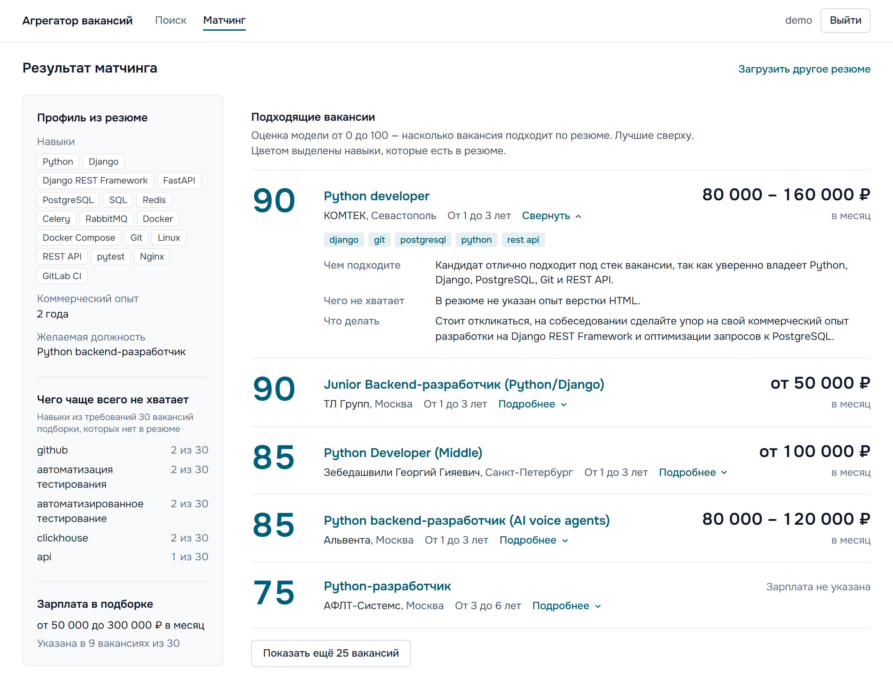

**Объяснения.** Пять лучших вакансий раскрыты: чем кандидат подходит, чего не хватает, что делать.

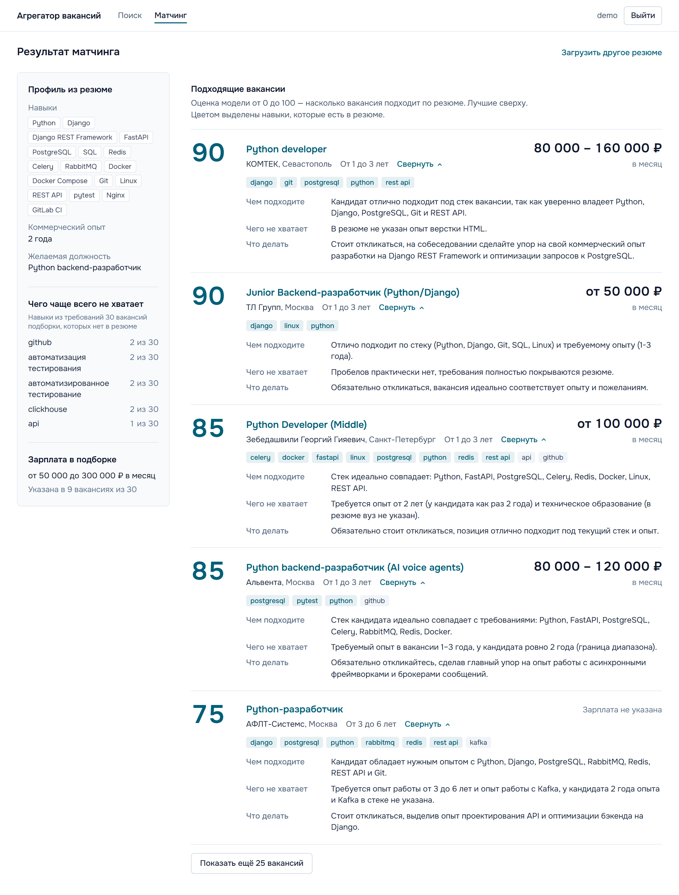

**Остальная подборка.** Ещё 25 вакансий — компактным списком.

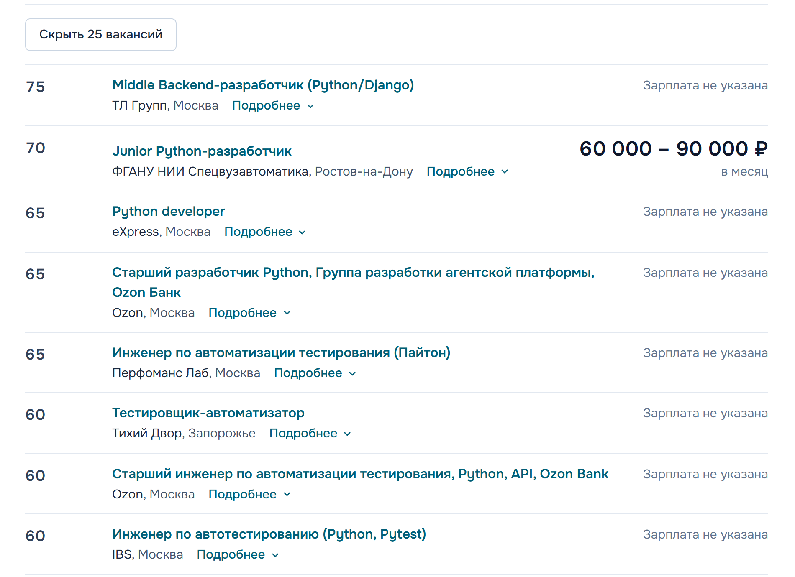

## Обновление базы

Раздел видит только администратор.

**Сводка.** Что в базе, последний запуск, справочник регионов hh.ru и пары для сбора.

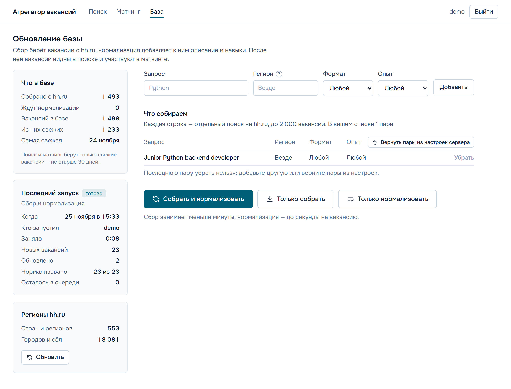

**Новая пара.** Можно выбрать несколько регионов — на каждый будет своя строка.

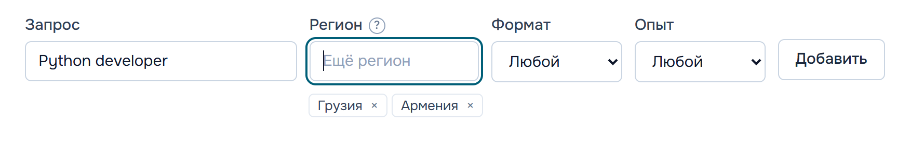

**Запуск.** Сбор и нормализация по стадиям, счётчики по ходу работы, остановка без потери сделанного.

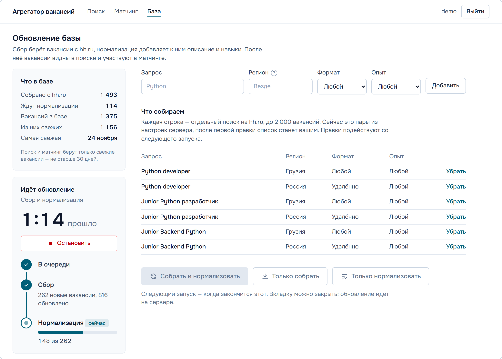
